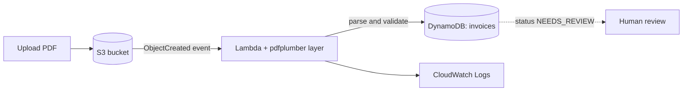

# Serverless Invoice Pipeline (AWS)

An event-driven pipeline that reads PDF invoices, extracts every line item, checks that the
numbers add up, and stores the result in DynamoDB. Invoices whose numbers do not reconcile are
flagged `NEEDS_REVIEW` for a human instead of being stored as valid data.

> **All invoices in this repo are synthetic.** Vendors, tax codes and prices are made up and
> generated by `scripts/generate_sample_invoices.py`. No real company data is used.

## Architecture



| Service | Role |
|---|---|
| S3 | Receives invoice PDFs; each upload triggers the Lambda |
| Lambda (Python 3.12) | Downloads the PDF, parses it with pdfplumber, validates the numbers |
| DynamoDB | Stores header fields, line items, VAT per rate, status and issues |
| IAM | Execution role limited to `s3:GetObject` on the bucket and `dynamodb:PutItem` on one table |
| CloudWatch Logs | Execution logs |

## What gets validated

For every invoice the parser checks that:

1. each line satisfies `qty x unit price = amount`
2. the sum of the lines equals the subtotal
3. VAT per rate (mixed 8% / 10% supported) matches the lines, allowing rounding
4. `subtotal - discount + VAT = grand total`
5. invoice number, date, subtotal and grand total are present

| Status | Meaning |
|---|---|
| `PARSED` | All checks passed |
| `NEEDS_REVIEW` | Parsed, but at least one check failed. The `issues` field says which |
| `FAILED` | The file could not be read |

## Sample layouts

Six synthetic invoices cover the layouts the parser has to cope with: bordered table, per-line
VAT column with mixed rates, no gridlines with non-standard headers, wrapped descriptions with
slightly misaligned columns, an English invoice with item codes and a discount, and one invoice
whose printed total is deliberately wrong. `sample_invoices/expected.json` holds the
known-correct answer for each.

## Project structure

```
src/invoice_parser.py        # parsing and validation (pure Python, no AWS imports)
src/lambda_function.py       # Lambda handler: S3 -> parser -> DynamoDB
tests/                       # pytest golden-file and unit tests
sample_invoices/             # synthetic PDFs + expected.json
scripts/generate_sample_invoices.py
```

## Run the tests locally

No AWS account needed.

```bash
python3 -m venv .venv
source .venv/bin/activate
pip install -r requirements-dev.txt
pytest -v
```

The suite has 15 tests: golden-file comparison for each sample invoice, unit tests for each
validation rule, a non-PDF input test, and a test that runs the real Lambda handler against
mocked S3 and DynamoDB.

## Deploying to AWS (manual, console)

1. Create an S3 bucket and a DynamoDB table `invoices` (partition key `source_key`, String, on-demand).
2. Build the pdfplumber layer in AWS CloudShell (Python 3.12, x86_64):

   ```bash
   mkdir -p layer/python
   pip3 install pdfplumber --target layer/python \
     --platform manylinux2014_x86_64 --implementation cp \
     --python-version 3.12 --only-binary=:all: --upgrade
   cd layer && zip -r9 ../pdfplumber-layer.zip python && cd ..
   aws lambda publish-layer-version --layer-name pdfplumber \
     --zip-file fileb://pdfplumber-layer.zip \
     --compatible-runtimes python3.12 --compatible-architectures x86_64
   ```

3. Create a Python 3.12 Lambda (512 MB, 30 s timeout), attach the layer, and paste
   `src/invoice_parser.py` and `src/lambda_function.py`.
4. Give the Lambda role least-privilege access: `s3:GetObject` on the bucket and
   `dynamodb:PutItem` on the table.
5. Add an S3 trigger for object-created events on `.pdf` files.

## Limitations

- The parser relies on text patterns, so it is tuned to the six layouts above. Real invoices
  have more variety, which is why unrecognised or inconsistent invoices are flagged rather than trusted.
- Only text-based PDFs are supported (no OCR for scanned documents).
- Invoices needing review are flagged in DynamoDB but not yet routed to a separate queue.

## Roadmap

- [ ] Infrastructure as code with Terraform
- [ ] GitHub Actions: run pytest on every push, then deploy
- [ ] CloudWatch alarm on `FAILED` / `NEEDS_REVIEW`
- [ ] LLM fallback for unrecognised layouts, with schema validation and human review of its output
