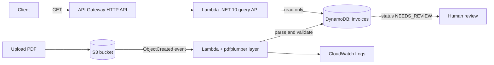

# Serverless Invoice Pipeline (AWS)


**Live demo:** https://y2vohpjxx2.execute-api.us-east-2.amazonaws.com/

An event-driven pipeline that reads PDF invoices, extracts every line item, checks that the
numbers add up, and stores the result in DynamoDB. Invoices whose numbers do not reconcile are
flagged `NEEDS_REVIEW` for a human instead of being stored as valid data.

> **All invoices in this repo are synthetic.** Vendors, tax codes and prices are made up and
> generated by `scripts/generate_sample_invoices.py`. No real company data is used.

## Architecture



| Service | Role |
|---|---|
| S3 | Receives invoice PDFs; each upload triggers the Lambda |
| Lambda (Python 3.12) | Downloads the PDF, parses it with pdfplumber, validates the numbers |
| DynamoDB | Stores header fields, line items, VAT per rate, status and issues |
| IAM | Execution role limited to `s3:GetObject` on the bucket and `dynamodb:PutItem` on one table |
| CloudWatch Logs | Execution logs |
| API Gateway + Lambda (.NET 10) | Read-only query API: list, look up and summarise invoices |

## What gets validated

For every invoice the parser checks that:

1. each line satisfies `qty x unit price = amount`
2. the sum of the lines equals the subtotal
3. VAT per rate (mixed 8% / 10% supported) matches the lines, allowing rounding
4. `subtotal - discount + VAT = grand total`
5. invoice number, date, subtotal and grand total are present

| Status | Meaning |
|---|---|
| `PARSED` | All checks passed |
| `NEEDS_REVIEW` | Parsed, but at least one check failed. The `issues` field says which |
| `FAILED` | The file could not be read |

## Sample layouts

Six synthetic invoices cover the layouts the parser has to cope with: bordered table, per-line
VAT column with mixed rates, no gridlines with non-standard headers, wrapped descriptions with
slightly misaligned columns, an English invoice with item codes and a discount, and one invoice
whose printed total is deliberately wrong. `sample_invoices/expected.json` holds the
known-correct answer for each.

## Project structure

```
src/invoice_parser.py        # parsing and validation (pure Python, no AWS imports)
src/lambda_function.py       # Lambda handler: S3 -> parser -> DynamoDB
tests/                       # pytest golden-file and unit tests
sample_invoices/             # synthetic PDFs + expected.json
scripts/generate_sample_invoices.py
terraform/                   # all AWS resources, including the query API (api.tf)
dotnet/src/InvoiceApi/       # ASP.NET Core minimal API (C#) that reads the invoices table
dotnet/tests/InvoiceApi.Tests/  # xUnit + Moq tests
```

## Query API (.NET)

A small ASP.NET Core minimal API runs on Lambda behind an API Gateway HTTP API. It only reads
DynamoDB (`GetItem` and `Scan` on one table), and every route is `GET`.

| Route | Returns |
|---|---|
| `GET /` | A plain-language page that shows each invoice, its status and the trusted totals |
| `GET /invoices?status=needs_review` | Invoices newest first, optionally filtered by status (any casing) |
| `GET /invoices/{source_key}` | One invoice with line items, VAT per rate and issues (404 if missing) |
| `GET /summary` | Counts by status and extraction method, money totals, and the keys that need attention |
| `GET /health` | `{"status": "ok"}` |

Money totals in `/summary` include `PARSED` invoices only, because flagged invoices are not
trusted until a human has checked them. An unknown status returns a 400 problem response.

The code is layered so each part can be tested on its own:

```
Program.cs (HTTP endpoints) -> InvoiceService (rules) -> IInvoiceRepository -> DynamoInvoiceRepository
```

The tests replace `IInvoiceRepository` with a Moq mock, so they need no AWS account. Endpoint
tests start the real HTTP pipeline in memory with `WebApplicationFactory`.

## Run the tests locally

No AWS account needed.

```bash
python3 -m venv .venv
source .venv/bin/activate
pip install -r requirements-dev.txt
pytest -v
```

The suite covers golden-file comparison for each sample invoice, unit tests for each
validation rule, a non-PDF input test, and a test that runs the real Lambda handler against
mocked S3 and DynamoDB.

For the .NET API (needs the .NET 10 SDK):

```bash
cd dotnet
dotnet test
```

GitHub Actions runs both suites on every push and pull request.

## Deploying with Terraform

```bash
# 1. Build the .NET API into dotnet/publish (Terraform zips this folder)
dotnet publish dotnet/src/InvoiceApi -c Release -r linux-arm64 --self-contained false -o dotnet/publish

# 2. Create or update every resource
cd terraform
terraform init
terraform apply -var="alert_email=you@example.com"

# 3. Try the API
curl "$(terraform output -raw api_url)summary"
```

## Deploying to AWS (manual, console)

1. Create an S3 bucket and a DynamoDB table `invoices` (partition key `source_key`, String, on-demand).
2. Build the pdfplumber layer in AWS CloudShell (Python 3.12, x86_64):

   ```bash
   mkdir -p layer/python
   pip3 install pdfplumber --target layer/python \
     --platform manylinux2014_x86_64 --implementation cp \
     --python-version 3.12 --only-binary=:all: --upgrade
   cd layer && zip -r9 ../pdfplumber-layer.zip python && cd ..
   aws lambda publish-layer-version --layer-name pdfplumber \
     --zip-file fileb://pdfplumber-layer.zip \
     --compatible-runtimes python3.12 --compatible-architectures x86_64
   ```

3. Create a Python 3.12 Lambda (512 MB, 30 s timeout), attach the layer, and paste
   `src/invoice_parser.py` and `src/lambda_function.py`.
4. Give the Lambda role least-privilege access: `s3:GetObject` on the bucket and
   `dynamodb:PutItem` on the table.
5. Add an S3 trigger for object-created events on `.pdf` files.

## Limitations

- The parser relies on text patterns, so it is tuned to the six layouts above. Real invoices
  have more variety, which is why unrecognised or inconsistent invoices are flagged rather than trusted.
- Only text-based PDFs are supported (no OCR for scanned documents).
- Invoices needing review are flagged in DynamoDB but not yet routed to a separate queue.
- The query API reads with `Scan`, which is fine for a demo table. A larger table would need a
  global secondary index on `status` and paginated responses.
- The API is public with throttling only. Real invoice data would need authentication
  (for example IAM or a JWT authorizer on API Gateway).

## Roadmap

- [x] Infrastructure as code with Terraform
- [x] GitHub Actions: run pytest on every push
- [x] CloudWatch alarm on `FAILED` / `NEEDS_REVIEW`
- [x] LLM fallback for unrecognised layouts, with schema validation and human review of its output
- [x] Read-only query API in .NET 10 (ASP.NET Core, xUnit, Moq) behind API Gateway
